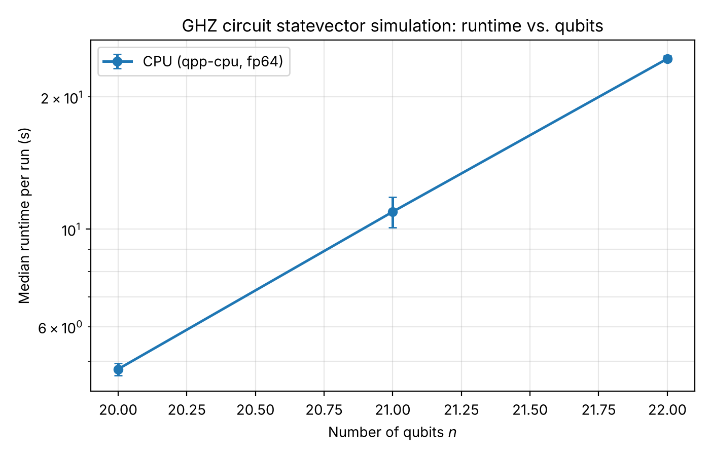
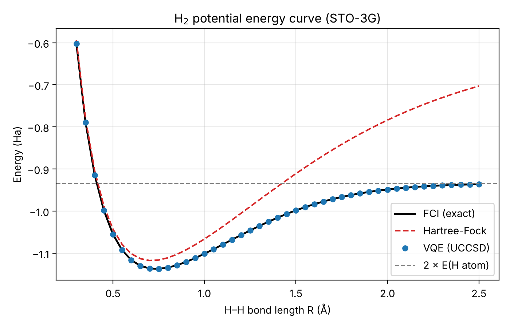
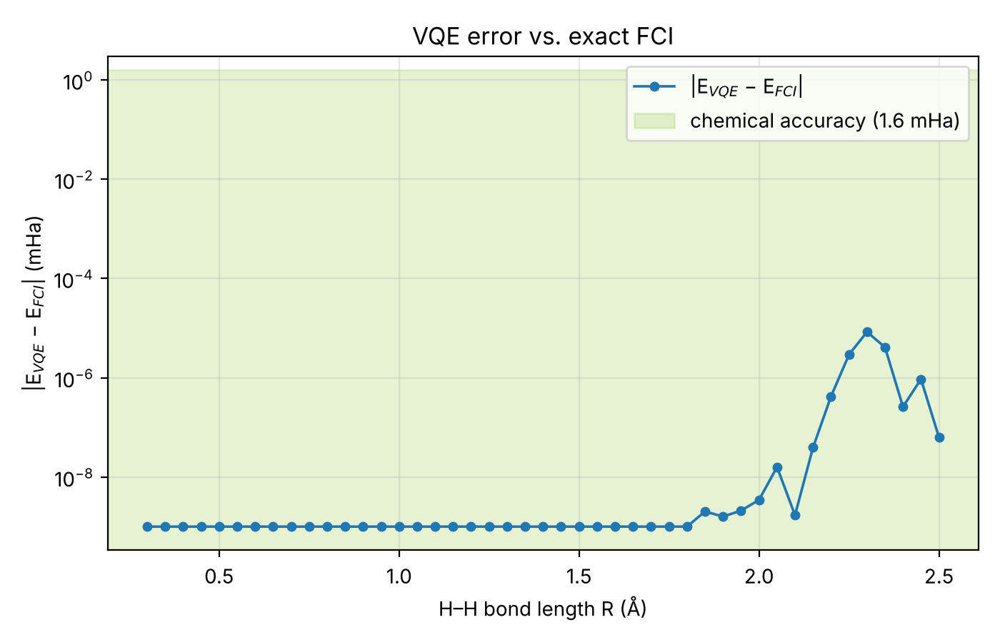
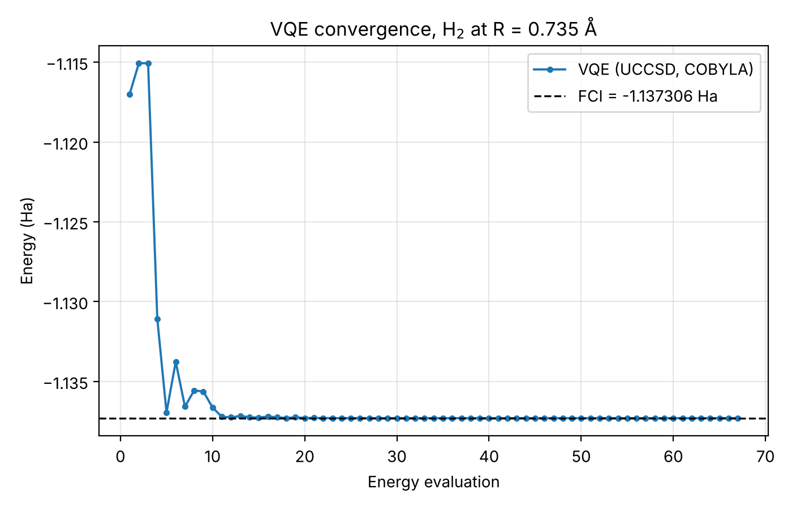

# gpu-quantum-sim

CPU statevector simulation of GHZ circuits was measured up to 22 qubits on this machine (no NVIDIA GPU was available, so the GPU comparison has not been measured yet). VQE with a UCCSD ansatz reproduces the H₂/STO-3G potential energy curve (45 bond lengths) with a maximum error of 8.4e-06 mHa versus exact FCI, inside chemical accuracy (1.6 mHa).

Built with [NVIDIA CUDA-Q](https://github.com/NVIDIA/cuda-quantum) 0.17: (1) a CPU-vs-GPU statevector benchmark on GHZ circuits and (2) VQE quantum chemistry on H₂, validated against exact FCI. Every number below is generated from `results/*.csv|json` by `src/report.py`.

> **GPU results pending.** This run had no NVIDIA GPU, so the `nvidia` target and the speedup plot were skipped. Run `notebooks/colab_quickstart.ipynb` on a free Colab T4, copy its `results/` files here and run `make report` to fill in the GPU numbers.

## Results

### GHZ statevector benchmark



| n | CPU median (s) | Est. memory (GiB) |
|---|---|---|
| 20 | 4.7999 | 0.016 |
| 21 | 10.9532 | 0.031 |
| 22 | 24.4388 | 0.062 |

### H₂ VQE (UCCSD, STO-3G)





- Hamiltonian: 15 Pauli terms (incl. identity) on 4 qubits; UCCSD has 3 parameters; optimizer: COBYLA.
- At R = 0.735 Å: E_VQE = -1.137306 Ha, E_FCI = -1.137306 Ha, error 1.5e-10 mHa (67 energy evaluations); Hartree-Fock: -1.116999 Ha.
- Equilibrium from a 1D minimisation of the VQE energy: R = 0.735 Å, E = -1.137306 Ha (same search on FCI: R = 0.735 Å, E = -1.137306 Ha). Lowest grid point: R = 0.75 Å.
- Max |E_VQE − E_FCI| over the sweep: 8.4e-06 mHa.

## Why this is hard

A dense n-qubit statevector holds 2ⁿ complex amplitudes: 8 bytes each in fp32, 16 in fp64. Memory doubles with every qubit (30 qubits = 8 GiB in fp32), and every gate touches every amplitude, so runtime grows exponentially too. GPUs help because the update is massively parallel and memory-bandwidth bound, which is exactly what they are built for.

## How VQE works

1. **Molecule:** H₂ at bond length R, STO-3G basis (2 electrons, 4 spin-orbitals).
2. **Hamiltonian:** PySCF integrals → fermionic Hamiltonian → Jordan-Wigner mapping → 4-qubit operator (15 Pauli terms).
3. **Circuit:** start in the Hartree-Fock state and apply a UCCSD ansatz (3 parameters) with `cudaq.kernels.uccsd`.
4. **Loop:** `cudaq.observe` returns ⟨ψ(θ)|H|ψ(θ)⟩; a classical optimizer (COBYLA) updates θ until the energy stops decreasing. In the bond sweep each point is warm-started from the previous optimum.

## Hardware used

- **CPU:** x86_64 (1 logical cores)
- **RAM:** 3.9 GiB
- **GPU:** none (CPU-only run)
- **Software:** CUDA-Q Version 0.17.0 (https://github.com/NVIDIA/cuda-quantum 1750574c92c613ff76c52fdbaa9289d864a3d640), Python 3.12.3, Linux-6.18.44-fc-v726-x86_64-with-glibc2.39

All VQE runs use the CPU target (`qpp-cpu`). The CPU target simulates in fp64, the GPU target in fp32, so the speedup mixes hardware and precision.

## Reproduce

```bash
git clone <this repo> && cd gpu-quantum-sim
make all        # install, test, GHZ benchmark, VQE sweep, regenerate README
make quick      # reduced run (< 2 min, CPU) -> results/quick/
```

Without an NVIDIA GPU the GPU target is skipped automatically. To get the GPU numbers, open `notebooks/colab_quickstart.ipynb` on a free Colab T4, copy the downloaded `results/` files into this repo and run `make report`. Tested on Python 3.12 / Linux x86_64 (use WSL2 on Windows); pins are in `requirements.txt`.

## Limitations

- This is **classical simulation** of quantum circuits, not quantum hardware.
- H₂ in STO-3G is small enough to solve exactly (FCI); it is used here as a validation target, not as a quantum-advantage claim.
- Benchmark numbers depend on the hardware, drivers and background load; compare only runs from the same machine.
- GHZ circuits are shallow and structured; timings measure one-shot `cudaq.sample` calls, including dispatch overhead.
- VQE energies are exact expectation values (no shot noise, no hardware noise).

## Résumé bullet

- Benchmarked CUDA-Q statevector simulation of GHZ circuits on CPU up to 22 qubits (GPU speedup: not yet measured, see note below); VQE with a UCCSD ansatz reproduces the H₂ potential energy curve within 8.4e-06 mHa of FCI (chemical accuracy).
